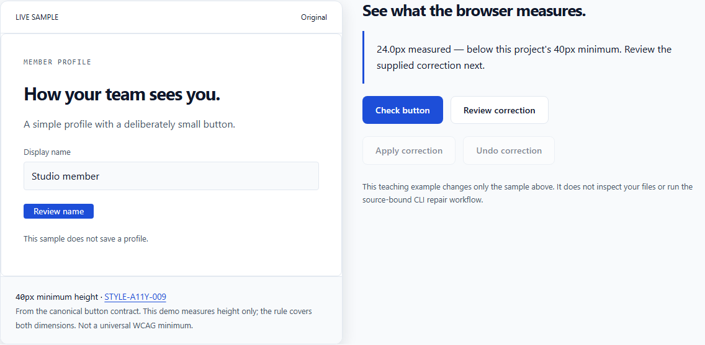
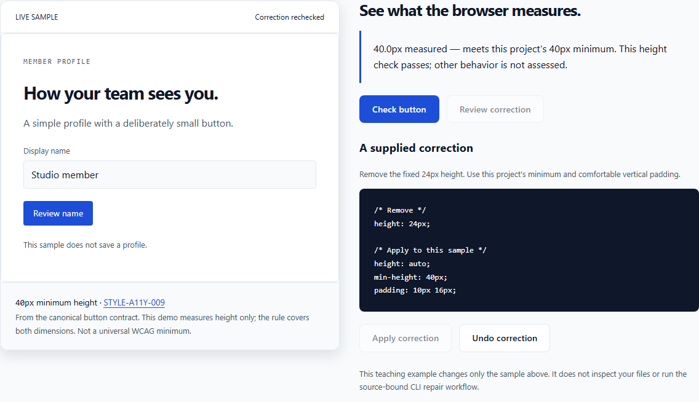
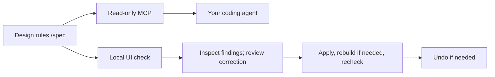
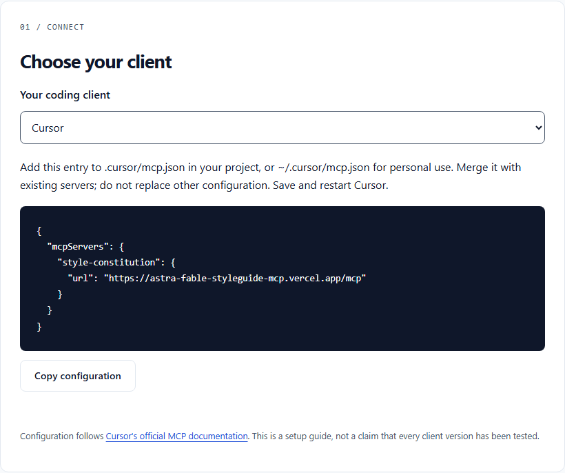
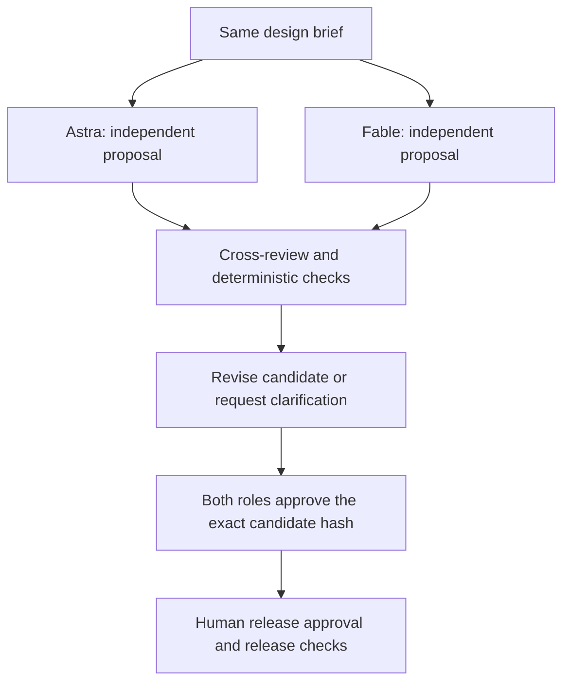

# Astra + Fable Style Constitution

**Give your coding agent shared design rules. Check the UI. Review the correction.**

Style Constitution helps developers check whether an AI-built interface follows their project's design rules. Give your coding agent approved colors, spacing and component rules, then measure selected parts of the rendered UI and review a correction when they differ.

Use it when a screen works but its design has drifted: a button is too small, a heading uses the wrong size, or a configured dialog does not return focus as expected. The rules live in a versioned `/spec` directory. You can use the rules or local checker with one coding agent, or without an AI model for local checks.

[**Try the demo →**](https://sulabhdubey.github.io/astra-fable-styleguide-mcp/demo/) · [Connect your agent](https://sulabhdubey.github.io/astra-fable-styleguide-mcp/start/) · [Install locally](docs/INSTALLATION.md) · [v0.10.1 release](https://github.com/sulabhdubey/astra-fable-styleguide-mcp/releases/tag/v0.10.1)

## Choose how to use it

| Your next task | Use | What you get |
| --- | --- | --- |
| Give your coding agent a consistent design reference | **Hosted MCP**, the connection between your agent and the rule server | Tokens, component rules and checks of submitted text/values. It does not open your app or inspect local files. |
| Check a supported page and review a correction | **Local CLI or Studio**, a browser interface running on your machine | Rendered findings with the element, expected rule and observed value; supported repair previews, rechecks and undo. No AI provider is required. |
| Experiment with two agents reviewing design proposals | **Astra + Fable collaboration** | Independent proposals, cross-review and approval of an exact candidate. Optional and experimental; not required for either workflow above. |

**Start small:** [try the browser demo](https://sulabhdubey.github.io/astra-fable-styleguide-mcp/demo/), then follow [one first-use path](docs/START_HERE.md). The released local checker supports configured static pages and trusted React/Vite production previews. Check [the scope](#supported-scope) before adapting a project.

## See a check in action

The browser measures a **24px button**, flags it against this project's **40px rule**, then measures again after you approve a supplied correction.

**1 · Find the mismatch**



**2 · Apply and recheck**



Actual v0.7.0 demo screenshots. This sample checks button height only; 40px is a project rule, not a universal accessibility minimum. **[Try it without an account, install or AI call.](https://sulabhdubey.github.io/astra-fable-styleguide-mcp/demo/)**

## How it works



| You want to… | Start with… |
| --- | --- |
| Give an agent consistent tokens and component rules | [Public MCP setup](#production-mcp) |
| Inspect a supported interface and review corrections | [Local Studio](docs/LOCAL_STUDIO.md) · [React/Vite guide](docs/RUNNING_APP.md) |
| Create and pin your team's design contract | [Constitution authoring](docs/CONSTITUTION_AUTHORING.md) |
| See new, resolved and incomplete checks in a PR | [PR regression summaries](docs/PR_REGRESSIONS.md) |
| Compare two repairs against one baseline | [Candidate comparison](docs/CANDIDATE_COMPARISON.md) — matching requirements, explicit ties and incomplete evidence |
| Hand findings to an agent, revisit history, or adopt team rules | [Individual and team workflows](docs/INDIVIDUAL_AND_TEAM_WORKFLOWS.md) — included in v0.10.0 |

For an individual developer, this makes selected design mismatches inspectable before accepting a change. For a design-system maintainer, it connects approved rules to agent instructions and browser measurements. For a reviewer, it records which source and rules were checked and what remains incomplete. Reduced review effort is a benefit to evaluate in your project, not a measured savings claim.

## Start locally

Use **Node 22.12+**, Git and **pnpm 10.34.5** for this source-checkout path:

```sh
git clone https://github.com/sulabhdubey/astra-fable-styleguide-mcp.git
cd astra-fable-styleguide-mcp
pnpm install --frozen-lockfile
pnpm build
pnpm stylecon browser-install
pnpm stylecon doctor
pnpm stylecon check examples/profile
```

Read the reported targets and findings. Exit **0** means all recorded checks passed, **1** means violations, and **2** means an error or incomplete check. A pass covers the configured checks only. To see a deliberately broken button, use the [local repair walkthrough](docs/DEMO.md); its first check is expected to fail.

Prefer the packaged CLI? Follow the [verified installation guide](docs/INSTALLATION.md). The CLI is distributed as a release archive; **it is not published to npm**.

## Production MCP

Add this to your client's MCP configuration; merge it with existing servers:

```json
{
  "mcpServers": {
    "style-constitution": {
      "url": "https://astra-fable-styleguide-mcp.vercel.app/mcp"
    }
  }
}
```

After connecting, ask your agent:

> Read the Style Constitution manifest and button/dialog rules. Explain which rules apply to my interface and cite their rule IDs. Separate declared rules from anything you have actually measured. Do not edit files yet.

Success means the client can list the eight public read/compliance tools and retrieve rules, not just display the server URL. No project account or provider key is required for this server; your agent may have its own model costs. Arguments you submit to the hosted tools are sent to that service. It cannot inspect or edit your local files, and connecting it does not automatically launch the local checker. [Client trial evidence](docs/CLIENT_TRIALS.md) · [TypeScript SDK](docs/TYPESCRIPT_CLIENT.md)

Opening `/mcp` in a normal browser can show “Method not allowed.” Use an MCP client with Streamable HTTP support, or open the [product site](https://sulabhdubey.github.io/astra-fable-styleguide-mcp/) to explore the project.

<details>
<summary>See the guided connection screen</summary>



[Open guided setup](https://sulabhdubey.github.io/astra-fable-styleguide-mcp/start/) · [Health](https://astra-fable-styleguide-mcp.vercel.app/health) · [Version](https://astra-fable-styleguide-mcp.vercel.app/version)

</details>

## Why Astra + Fable?

Two configurable agent roles independently propose design changes, then review them. They are roles, not fixed model vendors.



A changed candidate invalidates prior approvals. Unresolved requirements and pending checks block release. **Collaboration is experimental; an overall advantage over a single agent has not been demonstrated.** [Governance](GOVERNANCE.md) · [Measured comparison](docs/SELECTIVE_REVIEW_STUDY.md)

## Supported scope

- Configured static UI journeys and trusted local React/Vite production previews.
- Selected typography, spacing, contrast, overflow and interaction checks; [browser coverage](docs/RUNNING_APP.md) · [source-text checks](docs/COMPLIANCE.md).
- Supported repairs require explicit source mappings. React/Vite literal CSS corrections require a trusted rebuild before rechecking.
- Experimental [Dembrandt token comparison](docs/DEMBRANDT_TOKENS.md) checks declared colors against a versioned export using a controlled local render.
- Experimental software: no complete accessibility certification, arbitrary-framework coverage or autonomous repair guarantee.

## Go deeper

[Quickstart](docs/START_HERE.md) · [Repair walkthrough](docs/DEMO.md) · [Release notes](docs/V0.10.1_RELEASE_NOTES.md) · [Changelog](CHANGELOG.md) · [Deployment](docs/DEPLOYMENT.md)

<details>
<summary>Common questions: models, existing design systems, evidence and costs</summary>

**Do I need two models?** No. Astra and Fable are configurable roles in an optional collaboration workflow. The hosted rules and local checking work independently of that experiment.

**Can I use my team's design rules?** Yes: [create a reviewed constitution](docs/CONSTITUTION_AUTHORING.md), then [pin and adopt it locally](docs/INDIVIDUAL_AND_TEAM_WORKFLOWS.md). The public MCP serves this project's published constitution; local rule adoption does not change that shared endpoint.

**Does it replace Storybook or a full accessibility audit?** No. It measures selected, explicitly configured rules and journeys. The [Storybook development trial](https://github.com/sulabhdubey/astra-fable-styleguide-mcp/pull/56) is separate from the v0.10.1 release. Unsupported checks remain incomplete; arbitrary JSX repair is not supported.

**What has been demonstrated?** [Internal client trials](docs/CLIENT_TRIALS.md) show coding agents retrieving rules and reacting to findings, with failures recorded. The [repair demo](docs/DEMO.md) demonstrates a bounded browser-check and correction workflow. These are engineering examples, not evidence of widespread customer adoption. The [developer pilot](docs/DEVELOPER_PILOT.md) defines the repeat-use evidence still needed.

**Will it save tokens or guarantee better AI output?** Neither is established. Local checks do not call an AI provider. The [collaboration studies](docs/COLLABORATION_COMPARISON.md) and [selective-review experiment](docs/SELECTIVE_REVIEW_STUDY.md) record bounded results and do not demonstrate an overall two-agent advantage or general token savings.

</details>

<details>
<summary>Contributing and verification</summary>

```sh
pnpm install
pnpm lint
pnpm typecheck
pnpm test
pnpm validate
pnpm build
```

After installing Chromium, `pnpm test:product` checks the built product pages. CI requires no external AI calls.

[Project goal](GOAL.md) · [Build specification](BUILD_SPEC.md) · [Agent rules](AGENTS.md) · [Versioning](docs/VERSIONING.md)

</details>

Inspired by Tibo's post on X.
